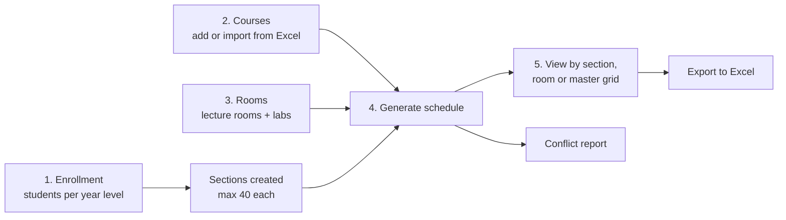
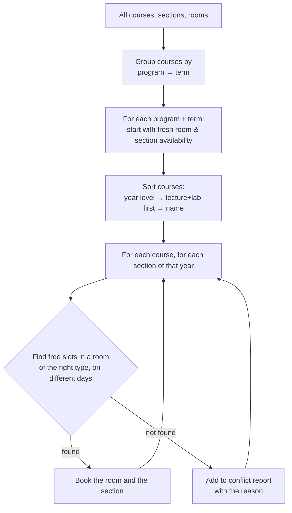
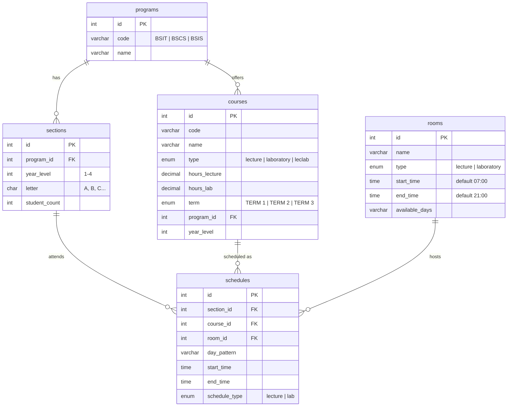

# Class Efficiency Scheduling System

An automatic class scheduler for **National University – Laguna**. Enter how many students are enrolled, add the courses and rooms, and the system generates a full weekly timetable: every section gets a room, days and a time for each class, and every placement is checked against existing room and section bookings. Anything that can't be placed is listed in a conflict report so you know exactly what to fix.


---

## Contents

- [Why we built it](#why-we-built-it)
- [Features](#features)
- [How to use it](#how-to-use-it)
- [How the scheduling algorithm works](#how-the-scheduling-algorithm-works)
- [Screens](#screens)
- [Tech stack](#tech-stack)
- [Database](#database)
- [Project structure](#project-structure)
- [API endpoints](#api-endpoints)
- [Getting started](#getting-started)
- [Further reading](#further-reading)
- [Team](#team)

---

## Why we built it

Building a class schedule by hand means juggling hundreds of courses, sections and rooms in a spreadsheet, and a single clash (two classes in one room, or one section in two places at once) can take hours to find. This system does the placement automatically, checks every slot for clashes as it goes, and reports anything it couldn't fit.

## Features

- **Enrollment → sections**: enter the number of students per program and year level, and sections are created automatically (up to 40 students each, split evenly: 75 students → sections A and B with 38 and 37)
- **Course management**: add, edit and delete courses for **BSCS, BSIS and BSIT**, years 1–4, as *lecture*, *laboratory* or *lecture + lab*, assigned to Term 1, 2 or 3
- **Excel import**: bulk-import courses from a spreadsheet, validated for required columns and valid programs, years, types and terms, with a downloadable template
- **Room management**: lecture rooms and computer labs, available 7:00 AM – 9:00 PM by default
- **One-click schedule generation** using the algorithm described below
- **Conflict report**: every class that couldn't be placed, with its course, section, term and the reason
- **Three schedule views**, each grouped by term:
  - **By section**: a class's full weekly timetable
  - **By room**: what's happening in each room
  - **Master grid**: everything at once
- **Excel export** of the generated schedule (`NU_Schedule_<date>.xlsx`)
- **Dashboard** with totals for sections, rooms and generated schedules, plus a step-by-step getting-started guide

## How to use it



## How the scheduling algorithm works

The scheduler is in [`backend/scheduler.js`](backend/scheduler.js). It's a **greedy, constraint-checking algorithm**: it places the hardest classes first, and every placement is checked against both the room's and the section's existing bookings.



### The rules it follows

| Rule | Detail |
| --- | --- |
| **Room type matches class type** | Lectures go to lecture rooms; laboratory classes go to labs; *lecture + lab* courses need both |
| **No double-booking** | Within a program's term, a room can't host two classes at once and a section can't attend two classes at once |
| **Sessions per week** | Years 1–2: **2 sessions** per course; Years 3–4: **1 session** (frees up room capacity) |
| **Different days** | A course's sessions for one section never land on the same day |
| **Days and times** | Monday – Saturday, starting on the hour or half hour, within each room's operating hours |
| **Session length** | BSIT: 2 h lecture, 2 h lab. BSCS / BSIS: 2 h 40 min lecture, 4 h lab |
| **Hardest first** | *Lecture + lab* courses are placed before lecture-only and lab-only courses because they need two free rooms |

### Why group by term?

Term 1, 2 and 3 classes never run at the same time, so they shouldn't compete for the same rooms. Scheduling each term separately, with fresh room availability, cut conflicts by roughly **80–90%** in our testing: a 146-course load went from **200+ conflicts** when scheduled all at once to minimal conflicts.

## Screens

| Page | What it's for |
| --- | --- |
| Dashboard | Totals and the getting-started steps |
| Enrollment | Enter students per program and year level to create sections |
| Courses | Add, edit, delete and Excel-import courses |
| Rooms | Add and remove lecture rooms and labs |
| Generate Schedule | Run the scheduler and read the conflict report |
| View Schedules | By section, by room or the master grid, plus Excel export |

<!--
Screenshots: save images in docs/screenshots/ and uncomment.

| Dashboard | Generated schedule |
| --- | --- |
|  |  |
-->

## Tech stack

| Layer | Technology |
| --- | --- |
| Frontend | React 19, Vite, Axios |
| Spreadsheets | [SheetJS (xlsx)](https://sheetjs.com/) for Excel import, template and export |
| Backend | Node.js, Express |
| Database | MySQL (via `mysql2`) |
| Dev tools | nodemon, ESLint |

## Database



## Project structure

```
algorithmproject/
├── backend/
│   ├── server.js        # Express API
│   ├── scheduler.js     # Scheduling algorithm (ScheduleGenerator)
│   ├── db.js            # MySQL connection pool
│   └── database.sql     # Schema + program seed data
├── frontend/
│   ├── src/
│   │   ├── index.jsx    # App: dashboard, enrollment, courses, rooms, generator, views
│   │   ├── main.jsx
│   │   └── App.css, index.css
│   └── vite.config.js
├── package.json         # Backend dependencies + scripts
└── *.md                 # Design notes (see Further reading)
```

## API endpoints

All endpoints are under `/api` and return JSON.

| Method | Endpoint | What it does |
| --- | --- | --- |
| GET | `/programs` | List programs |
| POST | `/sections/generate` | Create sections from enrollment numbers (clears existing sections and schedules) |
| GET | `/sections` | List sections |
| GET · POST | `/courses` | List courses · add one or many (used by Excel import) |
| PUT · DELETE | `/courses/:id` | Edit · delete a course |
| GET · POST | `/rooms` | List rooms · add rooms |
| DELETE | `/rooms/:id` | Delete a room |
| POST | `/schedules/generate` | Run the scheduler; returns the number of classes placed and the conflict list |
| GET · DELETE | `/schedules` | All schedules · clear them |
| GET | `/schedules/by-section/:sectionId` | One section's timetable |
| GET | `/schedules/by-room/:roomId` | One room's timetable |

## Getting started

### Requirements
- [Node.js](https://nodejs.org/) 20.19+ (required by Vite 7)
- MySQL 8 or MariaDB (XAMPP works)

### Setup

1. **Clone and install**
   ```bash
   git clone https://github.com/kyleparas47-beep/algorithmproject.git
   cd algorithmproject
   npm install
   cd frontend && npm install && cd ..
   ```
2. **Create the database**: run `backend/database.sql` in MySQL (phpMyAdmin → Import, or `mysql -u root < backend/database.sql`). It creates the `nu_scheduling` database, its tables and the three programs.
3. **Configure the connection** (optional): create a `.env` file in the project root if your MySQL login isn't the default `root` with no password:
   ```env
   DB_HOST=localhost
   DB_USER=root
   DB_PASSWORD=
   DB_NAME=nu_scheduling
   ```
4. **Start the API** (port 3000):
   ```bash
   npm run server
   ```
5. **Start the frontend** in a second terminal:
   ```bash
   cd frontend
   npm run dev
   ```
6. Open the URL Vite prints (usually <http://localhost:5173>) and follow the **Getting Started** steps on the dashboard.

> **Tip:** if you get many conflicts, the conflict report tells you which term is short on rooms. Add rooms (especially labs for *lecture + lab* courses) or spread courses more evenly across the three terms.

## Further reading

Design notes written while building and tuning the scheduler:

- [TERM_BASED_SCHEDULING.md](TERM_BASED_SCHEDULING.md): term grouping, sorting order and room-capacity math
- [SMART_SESSION_ALLOCATION.md](SMART_SESSION_ALLOCATION.md): why years 3–4 get one session per week
- [DIFFERENT_DAYS_FIX.md](DIFFERENT_DAYS_FIX.md): keeping a course's sessions on separate days
- [QUICKSTART_IMPROVEMENTS.md](QUICKSTART_IMPROVEMENTS.md) · [DEBUGGING_GUIDE_CHAIN_OF_THOUGHT.md](DEBUGGING_GUIDE_CHAIN_OF_THOUGHT.md) · [systemflow.md](systemflow.md)

## Team

Built by a team of 5 at National University – Laguna (2025).

- **Kyle Justine Paras**: Team lead · Full-stack developer · UI design
- Faith Barba
- Charles De Leon
- Christian De Ocampo
- Ellysa Del Prado

## License

Developed for academic purposes.
